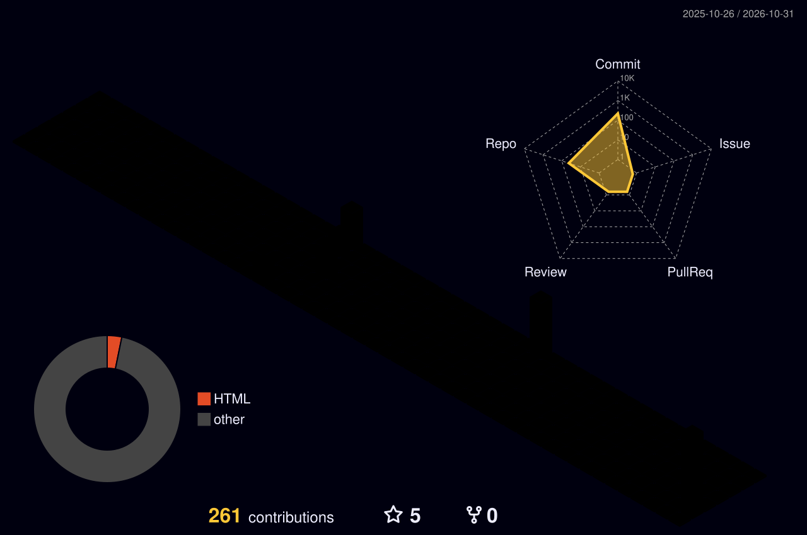

<div align="center">


<a href="https://bugrayetis.github.io"></a>

<br/>

<a href="mailto:bugrayetis305@gmail.com"></a>
<a href="https://www.linkedin.com/in/bu%C4%9Fra-yeti%C5%9F-593964249"></a>
<a href="https://instagram.com/bugrayetiss"></a>
<a href="tel:+905365957942"></a>


<br/><br/>

<a href="https://bugrayetis.github.io/mevcut.html#projects"></a>

<a href="https://bugrayetis.github.io"></a>
<a href="https://bugrayetis.github.io/yeni/"></a>

</div>

---

## `> whoami`

```typescript
const bugra: Developer = {
    ad:        "Buğra Yetiş",
    konum:     "İstanbul, Türkiye 🇹🇷",
    şirket:    "MAE Reklam Ajansı",
    rol:       "Mid Web Developer & Grafik Tasarımcı",
    deneyim:   "2022 → Devam Ediyor ⚡",

    günlükRutin: [
        "☕ Kahve",
        "💻 Kod yaz",
        "🎨 Tasarla",
        "📱 Mobil geliştir",
        "🎮 Oyun yap",
        "🚀 Deploy et",
        "🔁 Tekrarla"
    ],

    eğlenceliGerçek: "CSS yazmayı gerçekten seviyorum. 🎯"
};
```

### 🔥 Şu Anda

- 🏢 **MAE Reklam Ajansı**'nda Mid Web Developer
- 🎮 **Ev Kurma Oyunu** (co-op PC oyunu) ve **Yapay Zeka Ofis Otomasyonu** üzerinde çalışıyorum
- 🌱 **React Native / Expo**, **Three.js** & **AI Entegrasyonları** ile derinleşiyorum
- 🎯 **40+** proje: kurumsal siteler, e-ticaret, etkinlik ekranları, 3D, mobil uygulama ve oyunlar
- 📱 **5 uygulama**: OurDay, Protocol, Cem Ecevit TV, HobbyShare, Photobooth (iPad)
- ⚡ Piksel mükemmeliyetçisiyim, 1px bile fark ederim 👀

---

## 🧰 Teknoloji Arsenal

<div align="center">


<br/><br/>


<br/><br/>


</div>

---

## 📊 GitHub Aktivitem

<div align="center">




<picture>
  <source media="(prefers-color-scheme: dark)" srcset="https://raw.githubusercontent.com/BugraYetis/BugraYetis/output/github-snake-dark.svg" />
  
</picture>

</div>

---

## 💼 Çalışma Geçmişim

```
🟢 2024 — Devam Ediyor   ┃  Mid Web Developer / Grafik Tasarımcı
                          ┃  MAE Reklam Ajansı · İstanbul
                          ┃  ━━━━━━━━━━━━━━━━━━━━━━━━━━━━━━━━
                          ┃  ✦ React & GSAP ile animasyonlu kurumsal siteler
                          ┃  ✦ React Native & Expo ile mobil uygulamalar
                          ┃  ✦ Three.js / WebGL ile 3D web deneyimleri
                          ┃  ✦ Etkinlik galerileri, 4K giriş ekranları, iPad photobooth
                          ┃  ✦ AI entegrasyonları & ödeme altyapıları
                          ┃
🟡 2023 — 2024            ┃  Junior Web Developer
                          ┃  MAE Reklam Ajansı · İstanbul
                          ┃  ━━━━━━━━━━━━━━━━━━━━━━━━━━━━━━━━
                          ┃  ✦ HTML, CSS, Bootstrap ile tanıtım sayfaları
                          ┃  ✦ WordPress & Shopify site kurulumları
                          ┃  ✦ Sosyal medya tasarımları & marka kimliği
                          ┃
🔵 2022 — 2023            ┃  Stajyer / Grafik Tasarımcı
                          ┃  MAE Reklam Ajansı · İstanbul
                          ┃  ━━━━━━━━━━━━━━━━━━━━━━━━━━━━━━━━
                          ┃  ✦ Photoshop, Illustrator ile grafik tasarım
                          ┃  ✦ Etkinlik görselleri & fotoğraf düzenleme
                          ┃  ✦ HTML/CSS temelleri
```

---

## 📱 Uygulamalar & Oyunlar

> Tüm bağlantılar portfolyomdaki ilgili projeye gider; ekran görüntüleri ve detaylar orada.

<div align="center">

<a href="https://bugrayetis.github.io/mevcut.html#proje-ourday"></a>
<a href="https://bugrayetis.github.io/mevcut.html#proje-protocol"></a>
<a href="https://bugrayetis.github.io/mevcut.html#proje-cemtv"></a>
<a href="https://bugrayetis.github.io/mevcut.html#proje-hobbyshare"></a>
<a href="https://bugrayetis.github.io/mevcut.html#proje-photobooth"></a>
<a href="https://bugrayetis.github.io/mevcut.html#proje-evolving-ball"></a>
<a href="https://bugrayetis.github.io/mevcut.html#proje-pc-oyunu"></a>
<a href="https://bugrayetis.github.io/mevcut.html#proje-yapay-zeka-ofis-otomasyonu"></a>

</div>

---

## 🚀 Projeler

<div align="center">

### ★ Öne Çıkan

<a href="https://bugrayetis.github.io/mevcut.html#proje-mae-advertising-agency"></a>

### Yeni Eklenenler

<a href="https://bugrayetis.github.io/mevcut.html#proje-base"></a>
<a href="https://bugrayetis.github.io/mevcut.html#proje-alyans-logistics"></a>
<a href="https://bugrayetis.github.io/mevcut.html#proje-nomia"></a>
<a href="https://bugrayetis.github.io/mevcut.html#proje-fit-weekend-2026"></a>
<a href="https://bugrayetis.github.io/mevcut.html#proje-davetiye"></a>
<a href="https://bugrayetis.github.io/mevcut.html#proje-ep-fotograflar"></a>
<a href="https://bugrayetis.github.io/mevcut.html#proje-egitim-galerisi"></a>
<a href="https://bugrayetis.github.io/mevcut.html#proje-ep-giris-ekrani"></a>
<a href="https://bugrayetis.github.io/mevcut.html#proje-beny"></a>

### Web, 3D & Animasyon

<a href="https://bugrayetis.github.io/mevcut.html#proje-sosyal-medya-post-otomasyonu"></a>
<a href="https://bugrayetis.github.io/mevcut.html#proje-active-theory"></a>
<a href="https://bugrayetis.github.io/mevcut.html#proje-derinmavi"></a>
<a href="https://bugrayetis.github.io/mevcut.html#proje-fymension"></a>
<a href="https://bugrayetis.github.io/mevcut.html#proje-keramik-makina"></a>
<a href="https://bugrayetis.github.io/mevcut.html#proje-adria-karavan-turkiye"></a>
<a href="https://bugrayetis.github.io/mevcut.html#proje-cem-ecevit-tv"></a>
<a href="https://bugrayetis.github.io/mevcut.html#proje-3b-scroll-website"></a>
<a href="https://bugrayetis.github.io/mevcut.html#proje-online-kayit-sistemi"></a>
<a href="https://bugrayetis.github.io/mevcut.html#proje-countdown"></a>
<a href="https://bugrayetis.github.io/mevcut.html#proje-iconicrete"></a>
<a href="https://bugrayetis.github.io/mevcut.html#proje-derinet"></a>
<a href="https://bugrayetis.github.io/mevcut.html#proje-mae-site"></a>
<a href="https://bugrayetis.github.io/mevcut.html#proje-maritas-denim"></a>
<a href="https://bugrayetis.github.io/mevcut.html#proje-audrey"></a>
<a href="https://bugrayetis.github.io/mevcut.html#proje-joondalup-festival-2026"></a>
<a href="https://bugrayetis.github.io/mevcut.html#proje-touchscreen"></a>
<a href="https://bugrayetis.github.io/mevcut.html#proje-hero-dental-art"></a>
<a href="https://bugrayetis.github.io/mevcut.html#proje-shisha-detox"></a>
<a href="https://bugrayetis.github.io/mevcut.html#proje-kristoff-studio"></a>
<a href="https://bugrayetis.github.io/mevcut.html#proje-eggspander"></a>
<a href="https://bugrayetis.github.io/mevcut.html#proje-keramik"></a>
<a href="https://bugrayetis.github.io/mevcut.html#proje-mae-reklam"></a>
<a href="https://bugrayetis.github.io/mevcut.html#proje-incresis"></a>

</div>

<br/>

<div align="center">

| 📊 Rakamlarla Ben | |
|---|---|
| 🏗️ Tamamlanan Proje | **40+** |
| 📱 Uygulama & Oyun | **6** |
| 🛠️ Kullanılan Teknoloji | **30+** |
| 📜 Sertifika | **8+** |
| 🌍 Uluslararası Proje | **3+** |
| ☕ Tüketilen Kahve | **∞** |

</div>

---

## 🎓 Eğitim

```
🎓 2023 — 2025   ┃  Bilgisayar Programcılığı (Ön Lisans)
                  ┃  İstanbul Aydın Üniversitesi
                  ┃
🎓 2019 — 2023   ┃  Web Tasarım & Kodlama
                  ┃  Mesleki ve Teknik Anadolu Lisesi
```

---

<div align="center">

### 💬 *"İyi tasarım görünmezdir. İyi kod da öyle."*

<br/>

<a href="https://bugrayetis.github.io"></a>
<a href="mailto:bugrayetis305@gmail.com"></a>
<a href="https://www.linkedin.com/in/bu%C4%9Fra-yeti%C5%9F-593964249"></a>

<br/><br/>


</div>
